# PDF page router

The router classifies each page of a PDF and parses it with the cheapest backend that can handle it. The pages are merged back into one Markdown string, which `PyMuPDFScraper` returns through the existing `(content, image_urls, title)` contract.

The decisions, trade-offs and weak spots are summarised in [`DECISIONS.md`](../../../DECISIONS.md) at the repo root; this file holds the diagrams and the numbers.

Status: built and wired into `PyMuPDFScraper` (Phases 2–5). Both ways into it go through the router: `get_scraper()` for `.pdf` URLs, and `Scraper._retry_as_pdf()` when an HTML scraper got PDF bytes.

## Structure

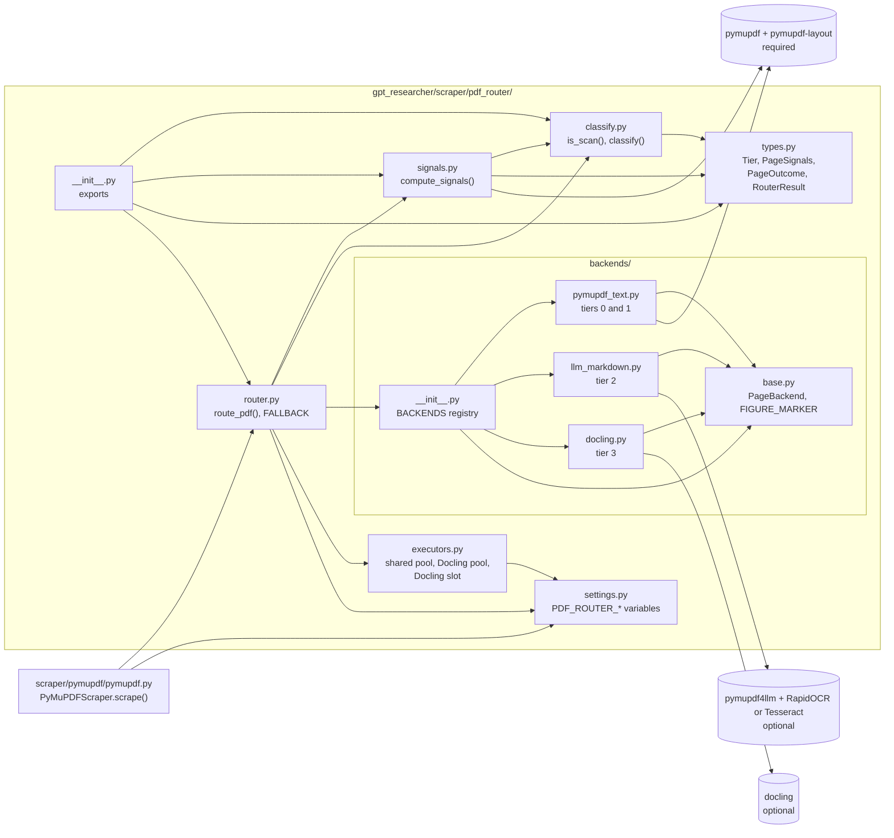

| File | Role |
| --- | --- |
| `types.py` | `Tier` (an `IntEnum`, so tiers can be compared), the frozen `PageSignals`, and `PageOutcome` / `RouterResult` |
| `settings.py` | The `PDF_ROUTER_*` environment variables, read at call time |
| `signals.py` | `compute_signals(page)`: one `get_text("dict")`, image info, and PyMuPDF's layout model (skipped on scans) |
| `classify.py` | `classify(signals, *, scan_ocr_available)`: a pure rule table |
| `backends/base.py` | The `PageBackend` protocol (`available()`, `parse(pdf, pages)`) and `FIGURE_MARKER` |
| `backends/pymupdf_text.py` | `render_page(page, tables=…)`, shared by tiers 0 and 1. `_reuse_layout()` stops `find_tables()` from running the model again |
| `backends/llm_markdown.py` | Tier 2 (pymupdf4llm) and `scan_ocr_available()` |
| `backends/docling.py` | Tier 3: one Docling call per document, via a sub-PDF of the routed pages |
| `router.py` | `route_pdf(pdf, source_url) -> RouterResult`: stage 1, stage 2, the fallback chain, the time budget and the merge |
| `executors.py` | Long-lived pools per process (`spawn`): the shared pool, the Docling pool, the Docling slot, and waiter threads |

## Turning it off

**What's optional:** `pymupdf` 2.0 already installs pymupdf4llm and the layout model, so tiers 0–2 always work. Only OCR (`rapidocr`, or a system Tesseract) and Docling are optional: `pip install "gpt-researcher[pdf-router]"`. Without them, scanned pages come back as `page N: not extracted` markers. Docling checks the Hugging Face Hub for its models every time a converter starts, so offline deployments need `HF_HUB_OFFLINE=1`.

`PDF_ROUTER_ENABLED=false` sends PDFs back through the old path: one `PyMuPDFLoader` pass over the whole file, joined with `\n`. Other settings: `PDF_ROUTER_MAX_WORKERS` (default `min(4, cpu)`), `PDF_ROUTER_DOCLING_CONCURRENCY` (default 1), `PDF_ROUTER_DOC_TIMEOUT_S` (default 120) and `PDF_ROUTER_WORKER_MAX_TASKS` (default 200: a shared worker is replaced after that many tasks, which releases memory the native libraries never hand back; 0 = never).

## How the scraper calls it

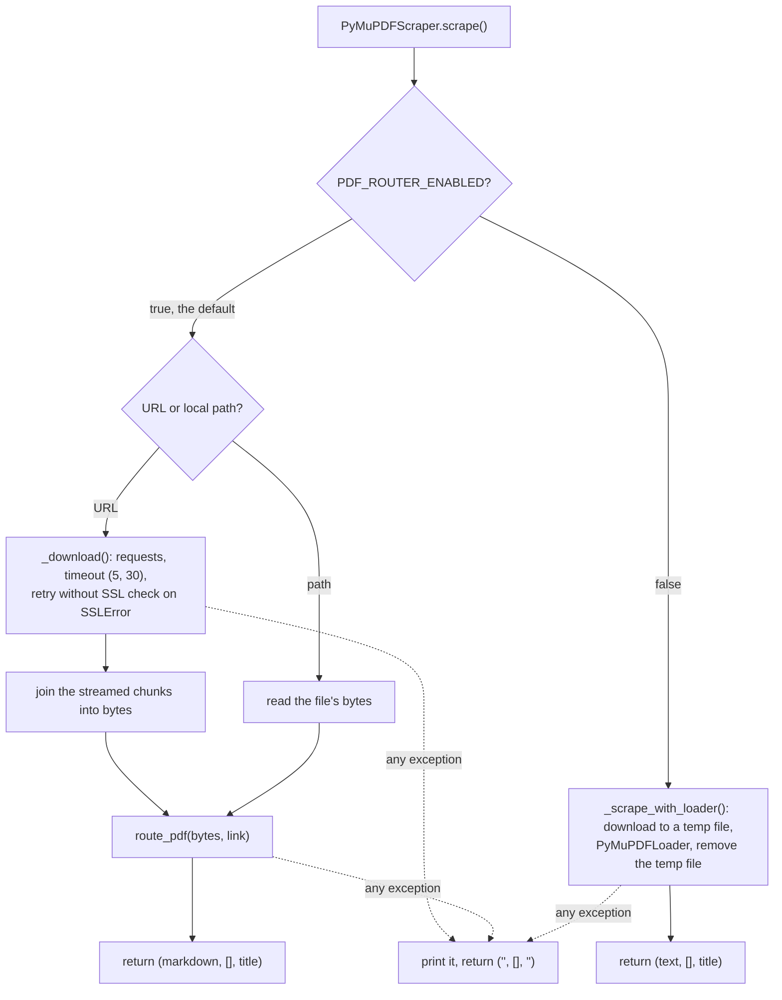

## Design: how a PDF goes through the router

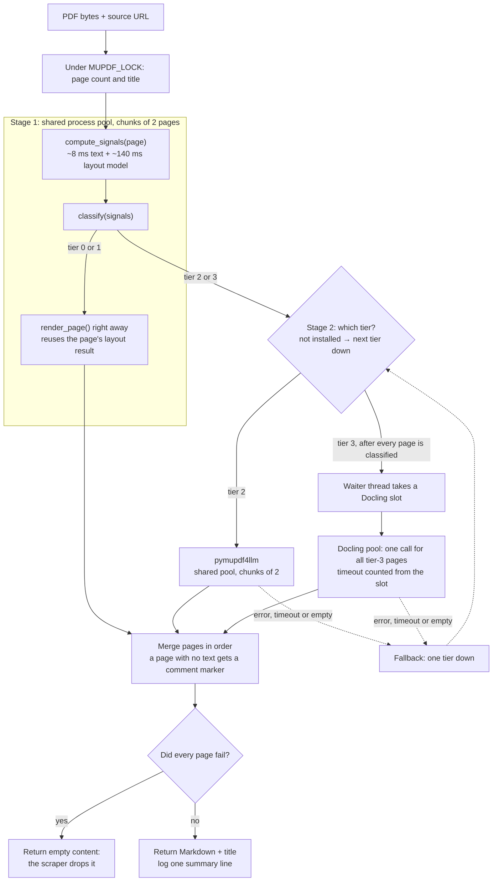

- **Docling slot:** at most `PDF_ROUTER_DOCLING_CONCURRENCY` Docling jobs run at once, across all PDFs. A job's timeout (30 s + 10 s × pages) starts once it holds a slot, so waiting behind another PDF's job never times it out. On a timeout, the Docling pool is stopped and rebuilt, because a running task can't be cancelled.
- **Document budget:** `PDF_ROUTER_DOC_TIMEOUT_S` (default 120 s) bounds the whole call. When it runs out, finished pages are returned and pages still in flight get a "document time budget exceeded" marker.
- **Tier 0/1 failures:** if rendering fails or returns nothing in stage 1, the page also goes to the fallback chain (tier 1 → tier 0).
- **Worker recycling:** shared workers are replaced after `PDF_ROUTER_WORKER_MAX_TASKS` tasks (`max_tasks_per_child`). A replacement costs ~1.2 s plus the model load, so the default of 200 keeps it rare. Docling workers are not recycled: a restart costs 8–20 s, and that pool has its own reset on timeout.

### Classification rules (`classify.py`)

The rules are checked in order, and the first match wins.

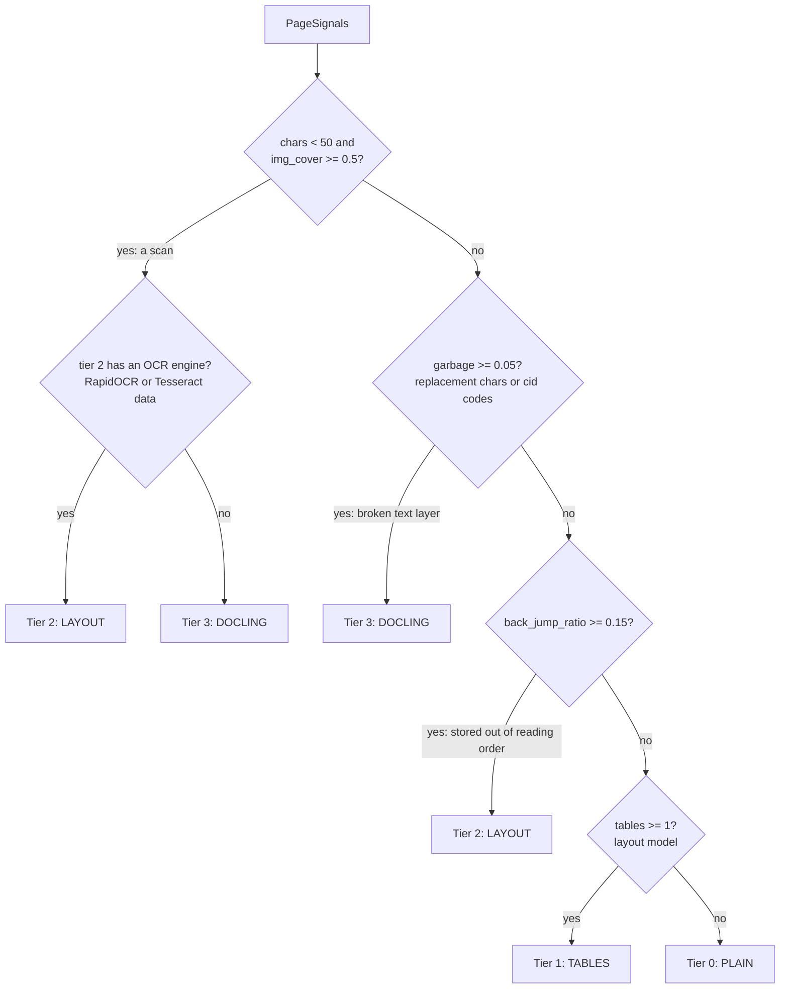

`pictures` (figures found by the layout model) never changes the tier. Every tier replaces the text inside a figure with `<!-- figure -->` and keeps the caption.

### Fallback chain (`router.FALLBACK`)

A tier that raises an error, times out, returns no text or isn't installed hands the page to the next tier down. If stage 1 itself fails (signals or classification), its pages go to tier 0. Each attempt is recorded in `PageOutcome.reason`. The chain only goes down, and every tier writes the same figure marker, so the placeholder also covers a failed tier.

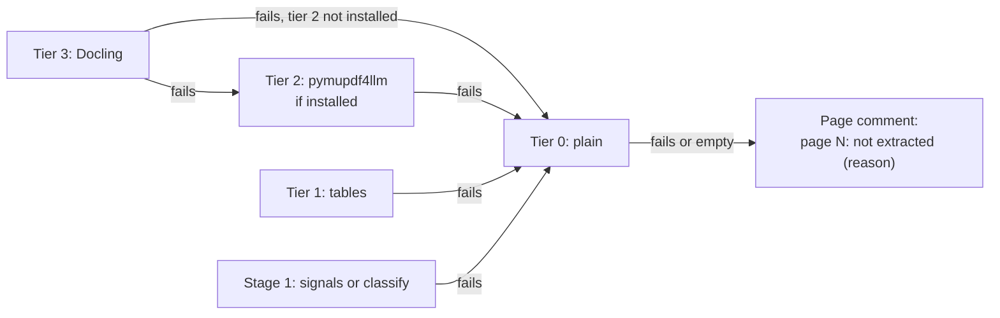

### Inside tiers 0 and 1 (`render_page`)

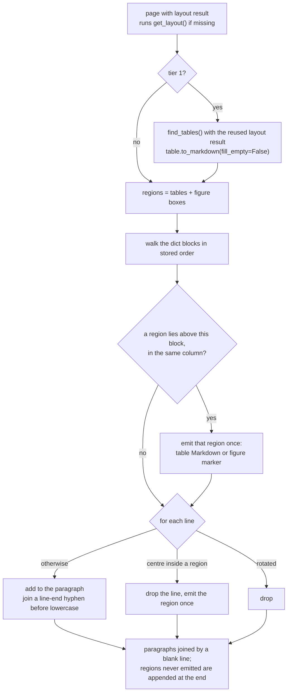

## Fixture flows

The tiers below were measured on the committed fixtures (`tests/fixtures/pdf/`), with OCR available (RapidOCR is installed here). The dashed arrows show what happens when an optional part is missing or a tier fails.

### `scanned-page.pdf` (1 page: a 1972 fax letter)

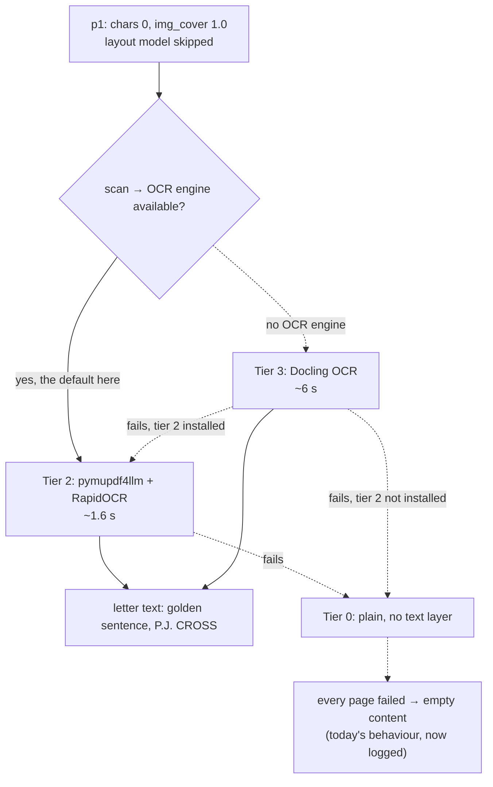

### `out-of-order-columns.pdf` (1 page, generated: two columns stored row by row)

Made with PyMuPDF by writing a two-column page one visual row at a time (left line 1, right line 1, left line 2, …), the way some Word and browser exports store text. The generator script was removed once the PDF was committed; it is in commit `0ad912ed`.

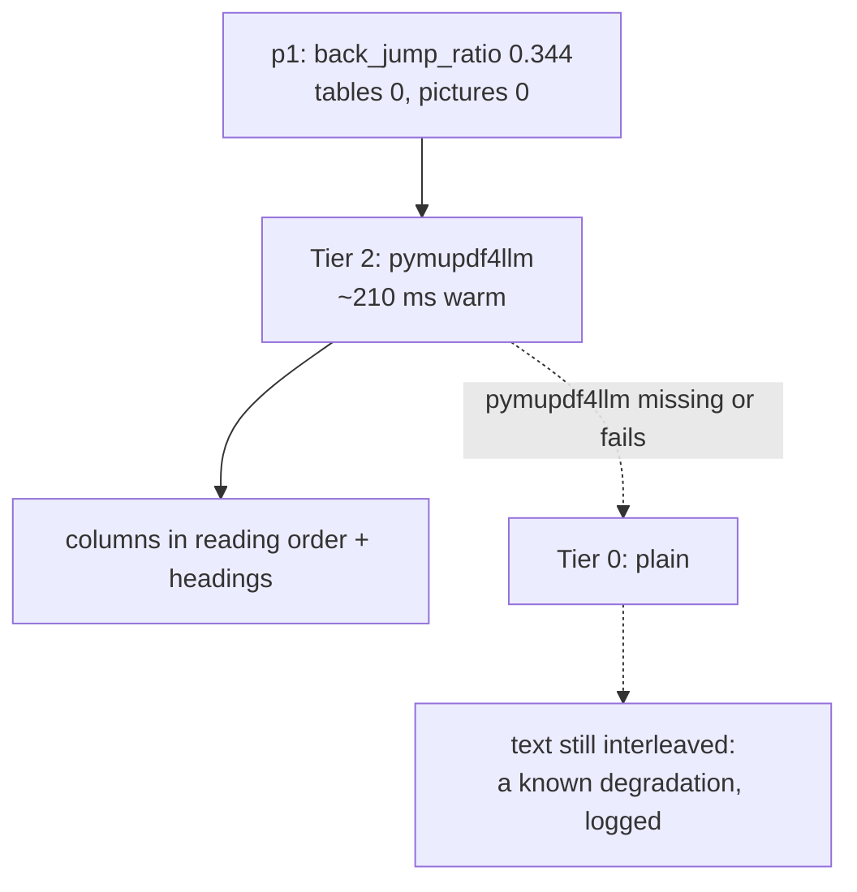

### `borderless-table.pdf` (RoBERTa, 13 pages, two columns, borderless tables)

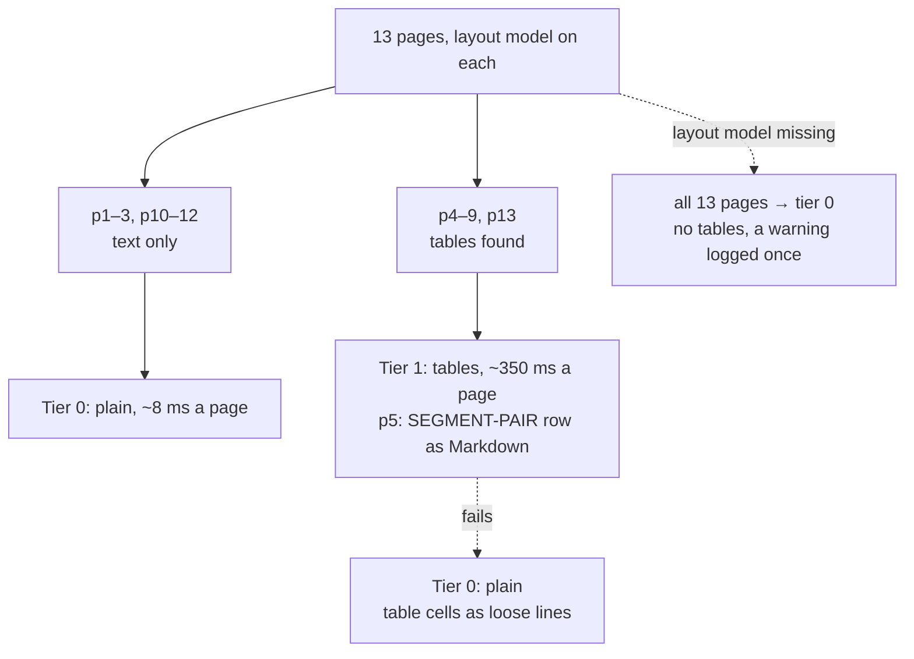

### `two-column-paper.pdf` (BERT, 16 pages, figures and tables)

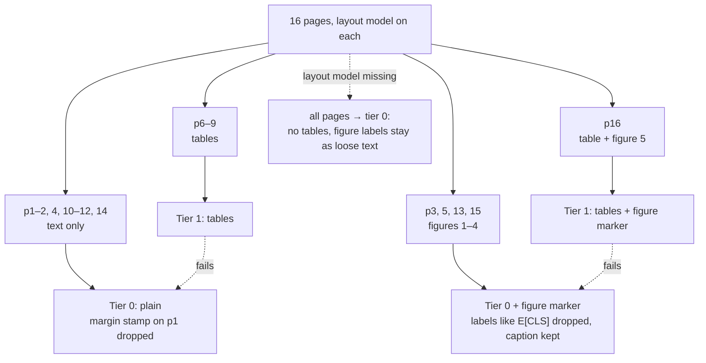

### `mixed-document.pdf` (5 pages: BERT p1–2, the scan, RoBERTa p5–6)

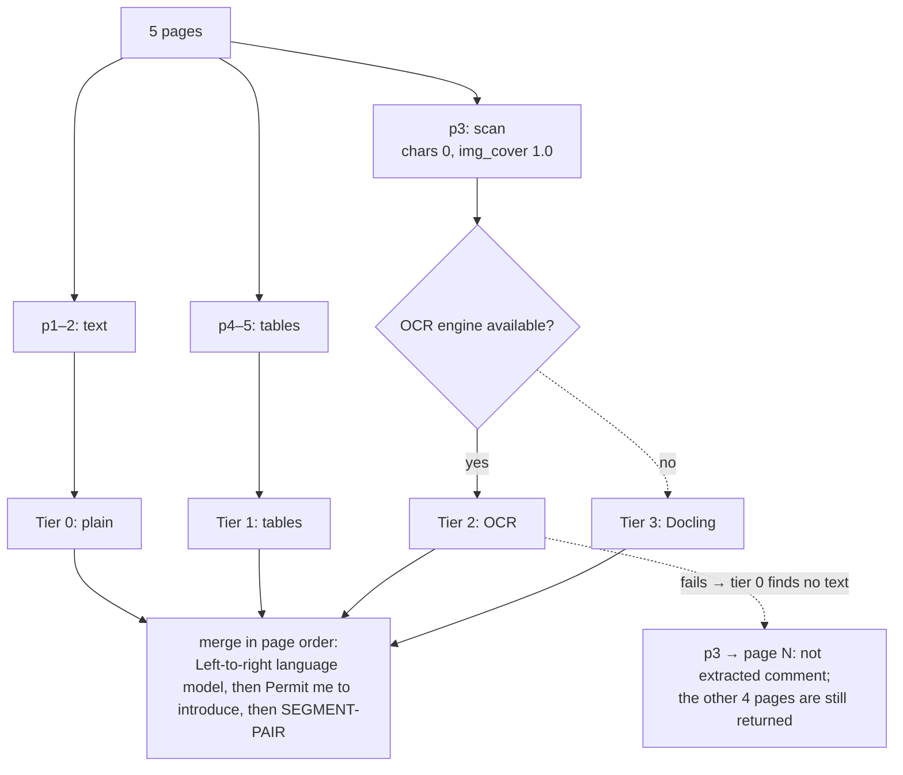

## Before / after (this Mac)

Golden snippets passed (`tests/pdf_router/golden.py`, what a person reads on the page) and time per document. "Today" is `PyMuPDFScraper` before the router (`PDF_ROUTER_ENABLED=false`). Router times are warm. Docling times start a new converter per file, so they include its start-up. The full per-check table is in `tests/fixtures/pdf/probe-output/comparison.md`, regenerated with `python tests/pdf_router/tools/probe.py --docling --router`.

| Fixture | Pages | Today | Router | Docling |
| --- | --- | --- | --- | --- |
| borderless-table (RoBERTa) | 13 | 2/3, 0.62 s* | 3/3, 1.99 s | 3/3, 20.41 s |
| mixed-document | 5 | 1/4, 0.02 s | 4/4, 2.76 s | 4/4, 12.50 s |
| out-of-order-columns | 1 | 2/3, 0.00 s | 3/3, 0.43 s | 3/3, 2.37 s |
| scanned-page | 1 | 1/4, 0.00 s | 4/4, 1.60 s | 4/4, 6.31 s |
| two-column-paper (BERT) | 16 | 1/3, 0.04 s | 3/3, 1.82 s | 3/3, 12.73 s |
| **Total** | 36 | **7/17** | **17/17** | **17/17** |

\* The first file also pays for loading `PyMuPDFLoader`; the others take 0.02–0.04 s.

The router matches Docling on every check at 4–10× less time. It's slower than today's extractor, which skips layout: the cost is the layout model (~140 ms a page) plus the process pool. One gap remains against Docling: no `##` headings on tier-0 pages (0 against Docling's 34 on BERT).

## End to end with real URLs

Through the real `Scraper` (the path a research step uses, quality gates included), run with `python tests/pdf_router/tools/e2e.py`. Details: `probe-output/e2e-mac.md`, `e2e-linux-docker.md`.

| URL | Mac | Linux (Docker) | Result |
| --- | --- | --- | --- |
| arxiv.org/pdf/1810.04805.pdf (BERT, 16 pp) | 3.7 s | 8.5 s | 45 table rows, 5 figure markers |
| arxiv.org/pdf/1907.11692.pdf (RoBERTa, 13 pp) | 2.5 s | 5.4 s | 83 table rows |
| arxiv.org/pdf/1706.03762.pdf (Attention, 15 pp) | 3.5 s | 9.3 s | 32 table rows, 3 figure markers |
| arxiv.org/pdf/2005.14165.pdf (GPT-3, 75 pp) | 15.2 s | 37.5 s | 562 table rows; 14 pages to tier 2 |
| arxiv.org/pdf/1810.04805 (no `.pdf`) | 0.2 s | 0.4 s | `ArxivScraper`: abstract only, the router never runs |
| arxiv.org/pdf/0000.00000.pdf (404) | 0.3 s | 0.5 s | dropped, as before |
| **All six at once** | 18.3 s, peak 3.4 GB | 54.3 s, peak 2.8 GB | 5 kept |

Times include the download; the workers were already started. The output is identical on both platforms, character for character. The arXiv PDFs have no title in their metadata, so the title is `""`, as before.

**Scanned PDFs with no text layer** (National Archives JFK releases, pages are images only; today's extractor returns `""` for them, so the source is dropped):

| URL | Pages | Mac | Result |
| --- | --- | --- | --- |
| archives.gov/files/research/jfk/releases/177-10001-10080.pdf | 2 | 6.3 s | both pages OCR'd (pymupdf4llm + RapidOCR), 2,547 chars; readable, with garbled runs where the scan is poor |
| archives.gov/files/research/jfk/releases/177-10001-10180.pdf | 38 | 68.3 s | 36 pages OCR'd; pages 16 and 19 are grey cover sheets with no readable text and become `page N: not extracted` markers |

OCR costs ~1.8 s a page here, so the default 120 s document budget covers about 65 scanned pages; longer scans return what finished and mark the rest.

### One research run, before and after

A script (since removed; it is in commit `5b4d6dfc` and needs a paid API key) ran `GPTResearcher` on exactly BERT's and RoBERTa's PDFs (no web search), once with the router and once without. Query: "How does RoBERTa change BERT's pre-training, and how much do those changes matter on SQuAD and MNLI?" Reports and the number check: `probe-output/research-*.md`.

- **Both reports are correct on the numbers they quote,** for example RoBERTa 94.6 / 89.4 / 90.2 against BERT-large 90.9 / 81.8 / 86.6. The report without the router even rebuilt RoBERTa's Table 2 exactly.
- **On these two papers the router made no visible difference.** In these LaTeX PDFs, today's extractor keeps table cells in reading order, one per line, and the model can rebuild the table from that.
- **The router's gains are elsewhere:** scans (today's output is empty, so the source is dropped), text stored out of order, and figure noise. See "Before / after".
- **Cost:** $0.11 with the router, $0.14 without (the repo's own estimates). With one run each, that difference is within noise.

## Measured cost per page (this Mac)

| Step | Cost |
| --- | --- |
| Signals (text + layout model) | ~150 ms median; layout model skipped on scans |
| Tier 0 (once the layout result is known) | ~8 ms |
| Tier 1 | ~350 ms median on table pages, mostly `table.to_markdown()`; ~8 ms on other pages |
| Tier 2 | ~210 ms warm, ~1 s cold; a scan ~1.6 s |
| Tier 3 | ~780 ms warm; ~8 s for the first call in a process |

### Whole documents (`route_pdf`, 4 shared workers, chunks of 2, warm, best of 3)

| Fixture | Pages | Time | Backends used |
| --- | --- | --- | --- |
| `two-column-paper` (BERT) | 16 | 1.84 s | plain 11, tables 5 |
| `borderless-table` (RoBERTa) | 13 | 1.84 s | plain 6, tables 7 |
| `mixed-document` | 5 | 2.24 s | plain 2, OCR 1, tables 2 |
| `scanned-page` | 1 | 1.59 s (OCR); 4.9 s via Docling, 15.6 s cold | pymupdf4llm, or docling without OCR |
| `out-of-order-columns` | 1 | 0.18 s | pymupdf4llm |

The first PDF in a process also pays ~1.2 s per worker to start (`spawn` re-imports the `gpt_researcher` package).

Memory per process (resident): shared worker ~260 MB at start, ~650–870 MB after parsing text PDFs, ~830–900 MB once it has also run OCR; Docling worker ~1.3 GB.

**Tried and rejected (2026-10-25): a dedicated OCR pool.** The idea was to keep OCR's models out of the shared workers by sending scanned pages to their own one-worker pool. Measured on the same machine, same documents: the 38-page scan went from 54.4 s to 62.5 s (four shared workers doing OCR were only 13% faster than one, so contention is real, but one worker still loses), and the six-URL peak went from 3.32 GB to 4.15 GB, because OCR adds only ~200–300 MB to a shared worker while the extra process holds ~1.1 GB and sits idle between scans. Reverted; an OCR worker that shuts down when idle is on the "another week" list.
