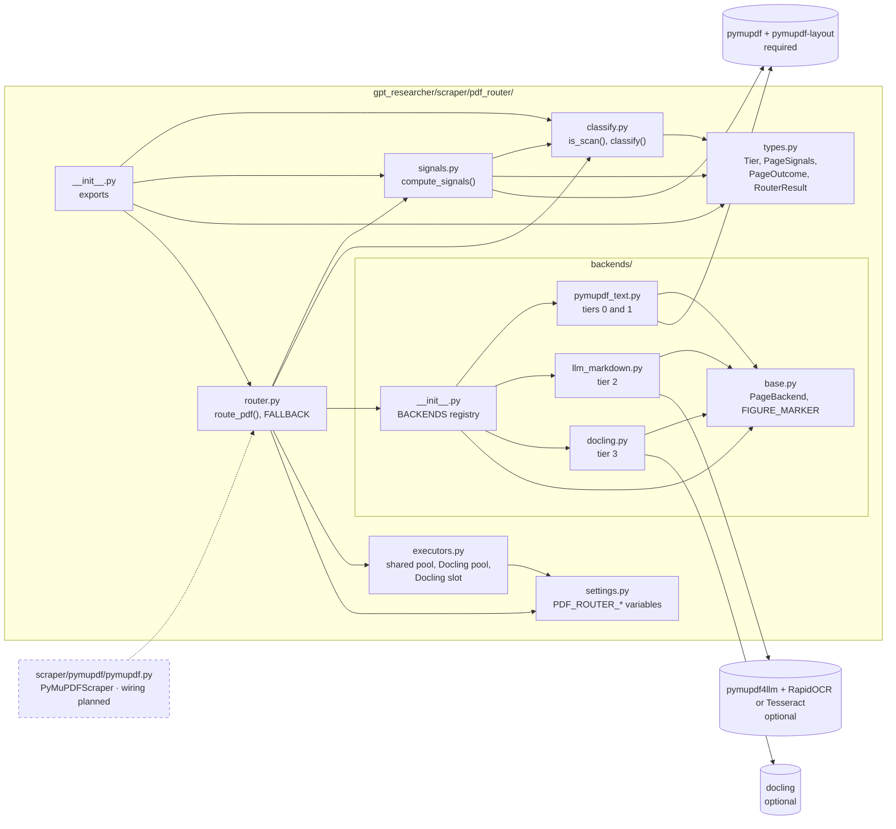
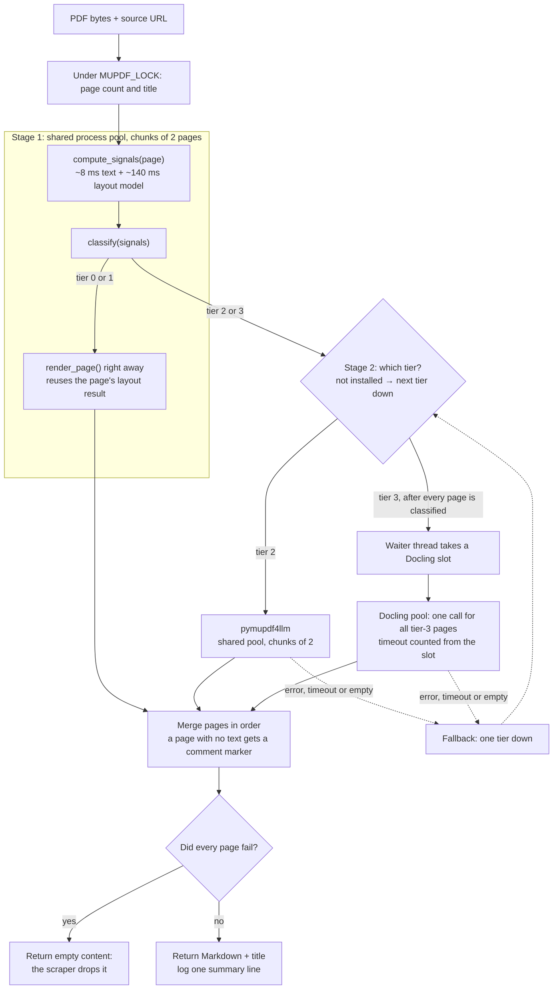
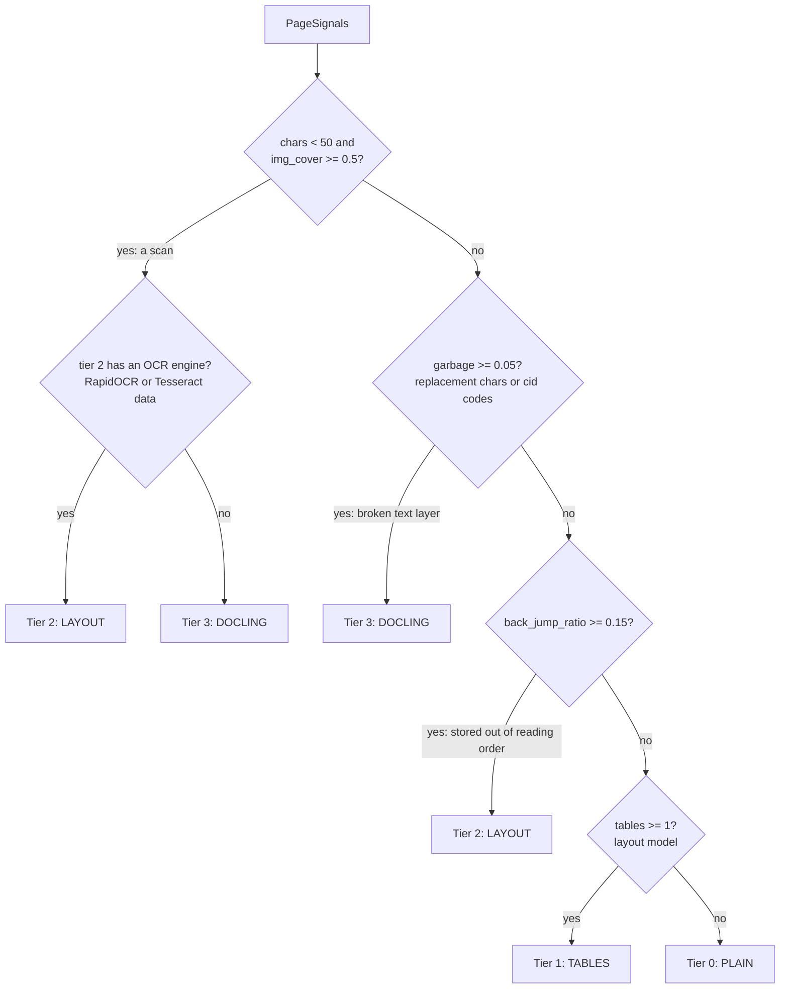
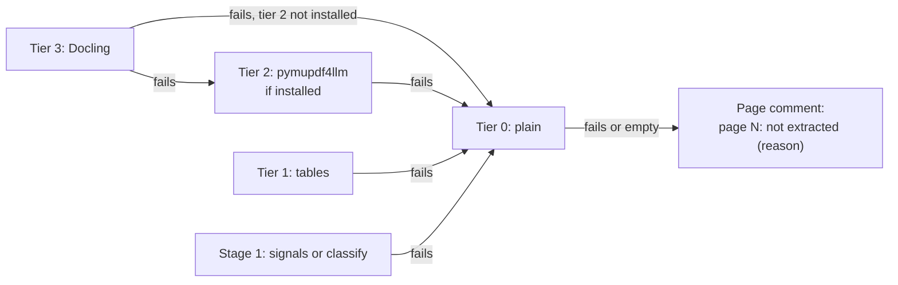
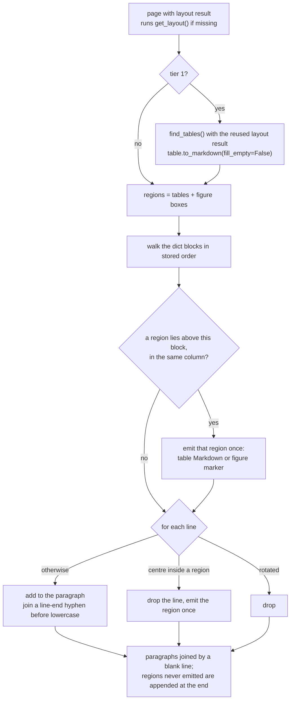
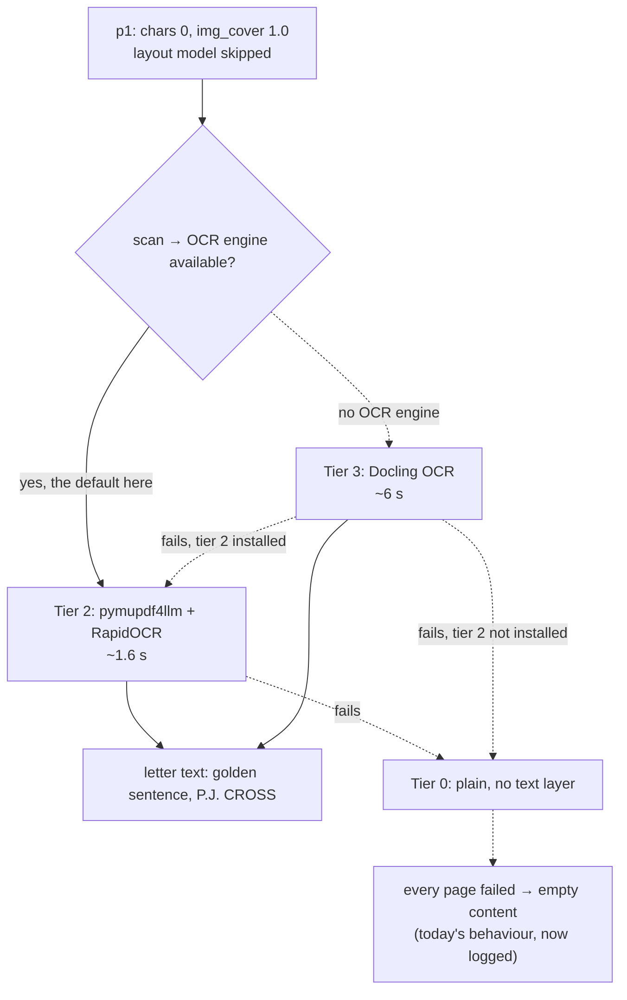
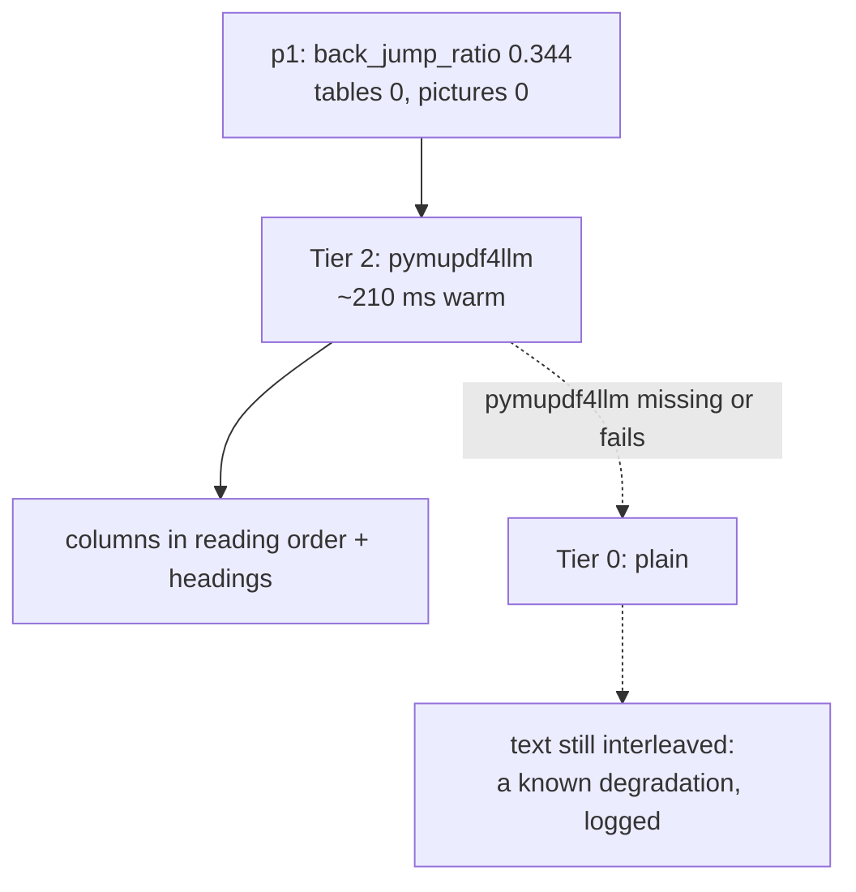
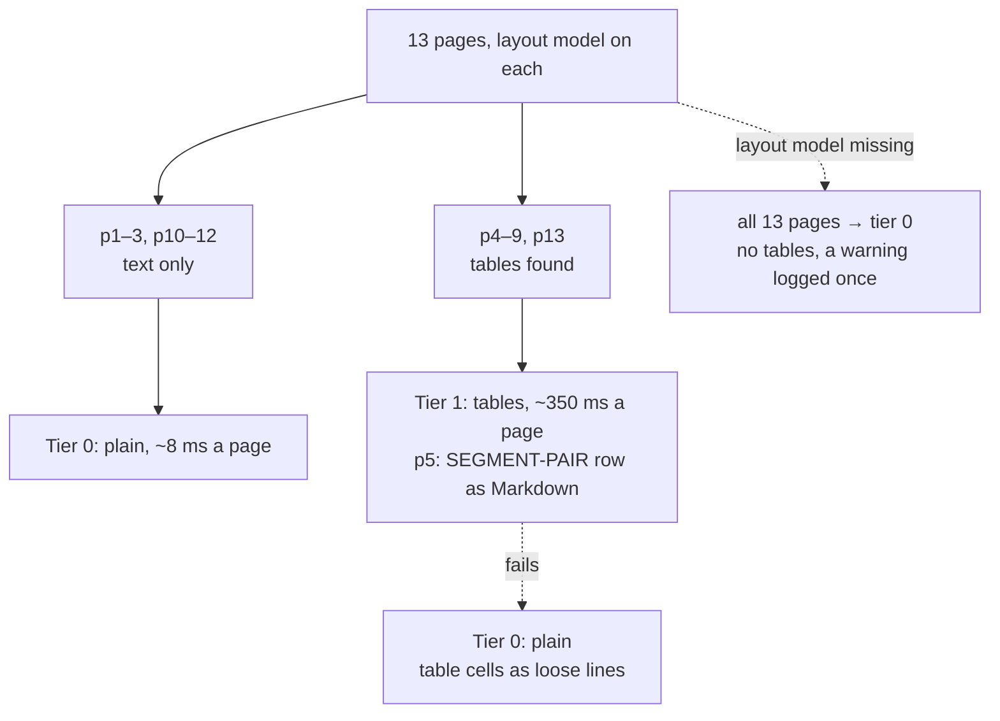
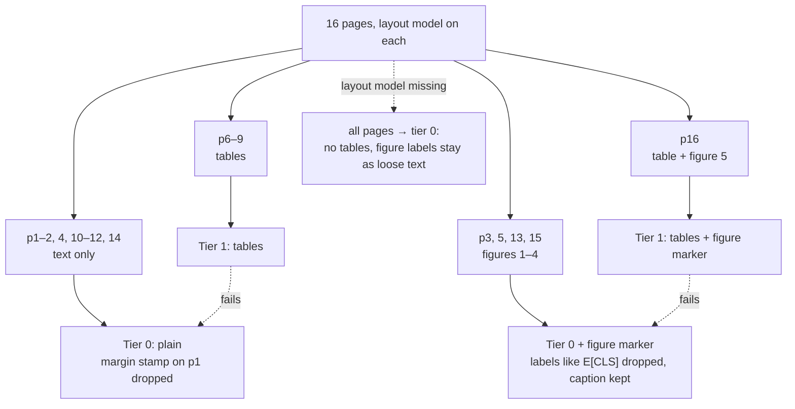
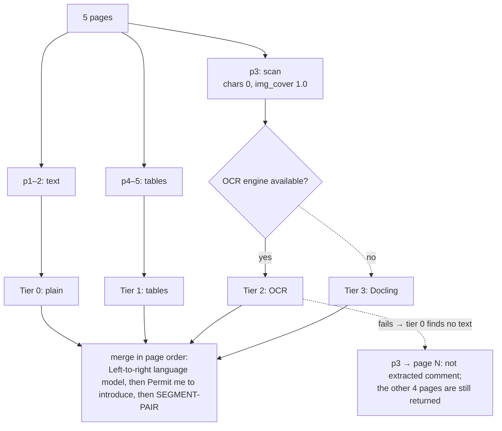

# PDF page router

The router classifies each page of a PDF and parses it with the cheapest backend that can handle it. The pages are merged back into one Markdown string, which `PyMuPDFScraper` returns through the existing `(content, image_urls, title)` contract.

Status: signals, classification, the four backends, the router, the process pools and the fallback chain are built (Phases 2–4). Only the scraper wiring (Phase 5) is still **planned**, so it's drawn dashed.

## Structure

| File | Role |
| --- | --- |
| `types.py` | `Tier` (an `IntEnum`, so tiers can be compared), the frozen `PageSignals`, and `PageOutcome` / `RouterResult` |
| `settings.py` | The `PDF_ROUTER_*` environment variables, read at call time |
| `signals.py` | `compute_signals(page)`: one `get_text("dict")`, image info, and PyMuPDF's layout model (skipped on scans) |
| `classify.py` | `classify(signals, *, scan_ocr_available)`: a pure rule table |
| `backends/base.py` | The `PageBackend` protocol (`available()`, `parse(pdf, pages)`) and `FIGURE_MARKER` |
| `backends/pymupdf_text.py` | `render_page(page, tables=…)`, shared by tiers 0 and 1. `_reuse_layout()` stops `find_tables()` from running the model again |
| `backends/llm_markdown.py` | Tier 2 (pymupdf4llm) and `scan_ocr_available()` |
| `backends/docling.py` | Tier 3: one Docling call per document, via a sub-PDF of the routed pages |
| `router.py` | `route_pdf(pdf, source_url) -> RouterResult`: stage 1, stage 2, the fallback chain, the time budget and the merge |
| `executors.py` | Long-lived pools per process (`spawn`): the shared pool, the Docling pool, the Docling slot, and waiter threads |

## Design: how a PDF goes through the router

- **Docling slot:** at most `PDF_ROUTER_DOCLING_CONCURRENCY` Docling jobs run at once, across all PDFs. A job's timeout (30 s + 10 s × pages) starts once it holds a slot, so waiting behind another PDF's job never times it out. On a timeout, the Docling pool is stopped and rebuilt, because a running task can't be cancelled.
- **Document budget:** `PDF_ROUTER_DOC_TIMEOUT_S` (default 120 s) bounds the whole call. When it runs out, finished pages are returned and pages still in flight get a "document time budget exceeded" marker.
- **Tier 0/1 failures:** if rendering fails or returns nothing in stage 1, the page also goes to the fallback chain (tier 1 → tier 0).

### Classification rules (`classify.py`)

The rules are checked in order, and the first match wins.

`pictures` (figures found by the layout model) never changes the tier. Every tier replaces the text inside a figure with `<!-- figure -->` and keeps the caption.

### Fallback chain (`router.FALLBACK`)

A tier that raises an error, times out, returns no text or isn't installed hands the page to the next tier down. If stage 1 itself fails (signals or classification), its pages go to tier 0. Each attempt is recorded in `PageOutcome.reason`. The chain only goes down, and every tier writes the same figure marker, so the placeholder also covers a failed tier.

### Inside tiers 0 and 1 (`render_page`)

## Fixture flows

The tiers below were measured on the committed fixtures (`tests/fixtures/pdf/`), with OCR available (RapidOCR is installed here). The dashed arrows show what happens when an optional part is missing or a tier fails.

### `scanned-page.pdf` (1 page: a 1972 fax letter)

### `out-of-order-columns.pdf` (1 page, generated: two columns stored row by row)

### `borderless-table.pdf` (RoBERTa, 13 pages, two columns, borderless tables)

### `two-column-paper.pdf` (BERT, 16 pages, figures and tables)

### `mixed-document.pdf` (5 pages: BERT p1–2, the scan, RoBERTa p5–6)

## Measured cost per page (this Mac)

| Step | Cost |
| --- | --- |
| Signals (text + layout model) | ~150 ms median; layout model skipped on scans |
| Tier 0 (once the layout result is known) | ~8 ms |
| Tier 1 | ~350 ms median on table pages, mostly `table.to_markdown()`; ~8 ms on other pages |
| Tier 2 | ~210 ms warm, ~1 s cold; a scan ~1.6 s |
| Tier 3 | ~780 ms warm; ~8 s for the first call in a process |

### Whole documents (`route_pdf`, 4 shared workers, chunks of 2, warm, best of 3)

| Fixture | Pages | Time | Backends used |
| --- | --- | --- | --- |
| `two-column-paper` (BERT) | 16 | 1.84 s | plain 11, tables 5 |
| `borderless-table` (RoBERTa) | 13 | 1.84 s | plain 6, tables 7 |
| `mixed-document` | 5 | 2.24 s | plain 2, OCR 1, tables 2 |
| `scanned-page` | 1 | 1.59 s (OCR); 4.9 s via Docling, 15.6 s cold | pymupdf4llm, or docling without OCR |
| `out-of-order-columns` | 1 | 0.18 s | pymupdf4llm |

The first PDF in a process also pays ~1.2 s per worker to start (`spawn` re-imports the `gpt_researcher` package).

Memory per process (resident): shared worker ~260 MB at start, ~650 MB after parsing, ~1.2 GB once it has run OCR; Docling worker ~1.3 GB.
